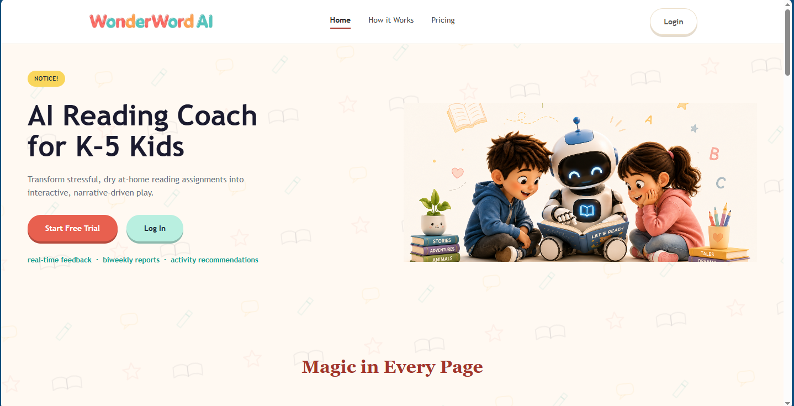
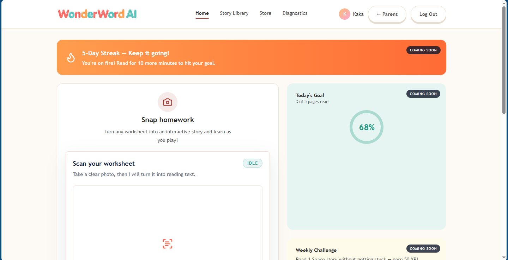
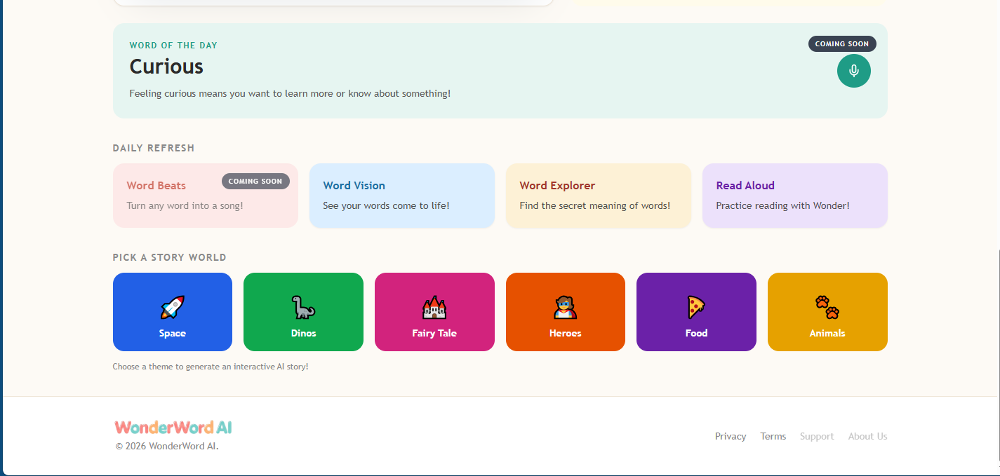
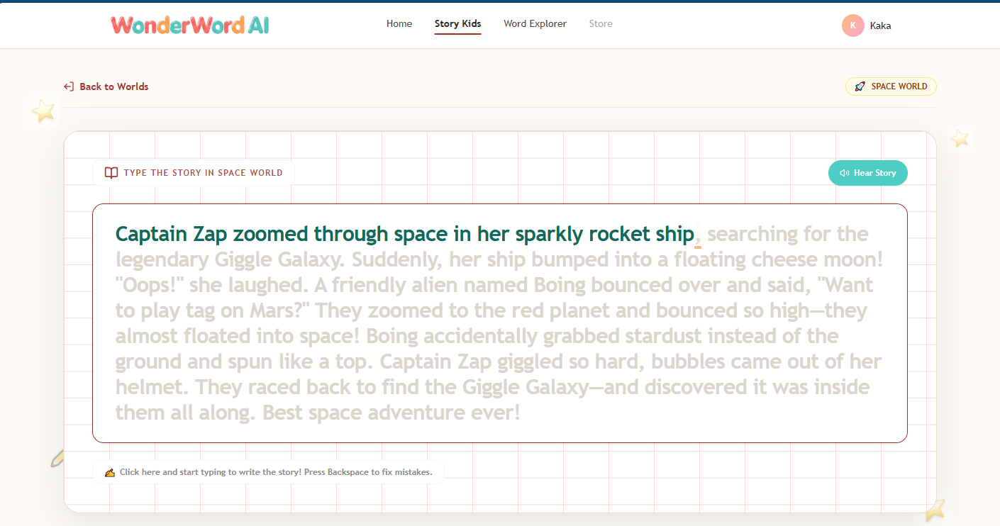
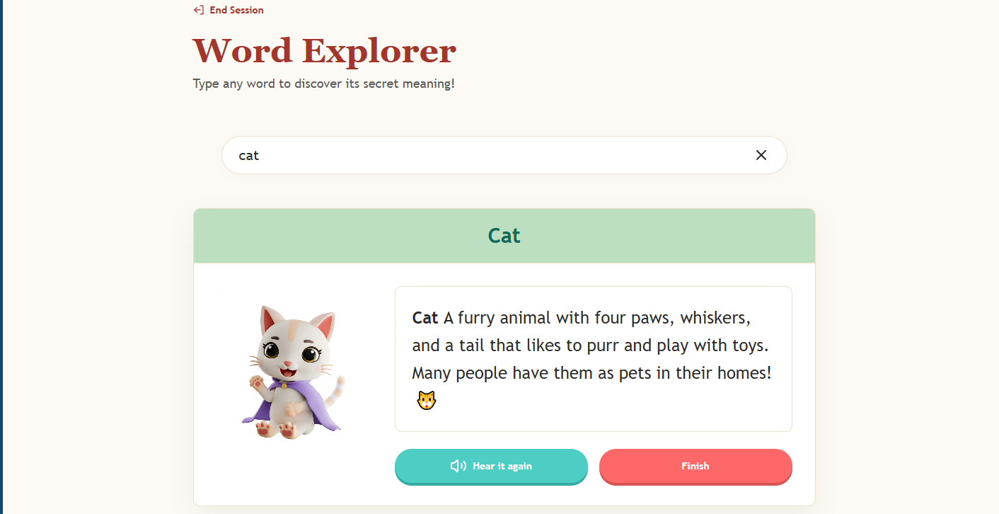

# 📚 WonderWord AI

> **AI-Powered Reading Coach for K-5 Kids**  
> *Transforming stressful, dry at-home reading assignments into interactive, narrative-driven play.*

Developed under the **Product Manager Accelerator** program by an international cross-functional team.

---

## 📸 Overview & Screenshots

| Landing Page | Homework Scanner & Dashboard |
| :---: | :---: |
|  |  |

| Word of the Day & Story Worlds | Interactive Read-Aloud (Karaoke Mode) |
| :---: | :---: |
|  |  |

  <b>Word Explorer (Kid-Friendly Dictionary)</b> 
  

---

## ✨ Key Features

- **📷 Snap Homework (AI Worksheet Scan):** Snap a picture of any printed worksheet or book page to convert it instantly into interactive reading material using Vision AI (Anthropic Claude).
- **🎤 Real-Time Karaoke & Speech Alignment:** Word-by-word highlighted playback and speech alignment built on WhisperX and Web Audio API.
- **🚀 Narrative Story Worlds:** Generate custom interactive AI stories tailored to children's interests (Space, Dinosaurs, Fairy Tales, Heroes, Food, Animals).
- **🔍 Word Explorer & Phonics Engine:** Tap or search any word to reveal visual definitions, child-friendly explanations, and phonetic pronunciations.
- **🏆 Gamification & Daily Streaks:** Keep children motivated with daily reading streaks, weekly challenges, and progress goals.
- **📊 Parent Dashboard & Analytics:** Comprehensive parent portal for tracking reading frequency, vocabulary expansion, and biweekly progress insights.

---

## 🛠️ Tech Stack

### **Frontend & Web Application (`/apps/web`)**
- **Framework:** [Next.js 14](https://nextjs.org/) (App Router, Server Components & Client Boundaries)
- **Language:** TypeScript
- **Styling:** Tailwind CSS, PostCSS
- **Server State Management:** TanStack Query (React Query v5)
- **UI Components & Charts:** Lucide React, Recharts
- **Quality & Testing:** Vitest (Unit & Integration), Playwright (E2E Testing)

### **Backend & Database**
- **Database & Auth:** [Supabase](https://supabase.com/) (PostgreSQL with RLS - Row Level Security, Supabase Auth)
- **Payments:** Stripe Integration

### **Machine Learning & AI Service (`/apps/ml-service`)**
- **Framework:** FastAPI (Python 3.11+)
- **Speech-to-Text & Alignment:** [WhisperX](https://github.com/m-bain/whisperX) + PyTorch
- **Generative AI & LLMs:** Anthropic Claude API (Vision & Story Generation), OpenAI API
- **NLP & Phonics:** Phonemizer, spaCy, Sentence-Transformers, Textstat
- **Monitoring:** Sentry SDK

---

## 👨‍💻 My Key Contributions

As an AI & Full-Stack Engineer on the team, I focused on agent systems, multimodal AI pipelines, and end-to-end service integration:

- **Story-Generation AI Agent System & Cost Routing:** Engineered a multi-LLM agent system (OpenAI & Anthropic Claude) dedicated to generating interactive, personalized children's stories. Implemented context-aware prompt flows and dynamic model routing (delegating simpler tasks to Haiku and complex reasoning to Sonnet), achieving an estimated **60–70% reduction in LLM API operational costs**[cite: 1].
- **RAG & Vector Database Storytelling Pipeline:** Designed and integrated a Retrieval-Augmented Generation (RAG) architecture connected to the database, retrieving relevant contextual knowledge, themes, and vocabulary to ground story generation and eliminate narrative hallucinations.
- **Callback Systems & Media Optimization (Unsplash API):** Implemented custom callback architectures and integrated queries against remote media databases (Unsplash API) to dynamically fetch visual assets instead of on-the-fly generative rendering, targeting an **~80% reduction in media generation overhead**[cite: 1].
- **AI/ML Service, OCR & STT Migration:** Contributed to the Python FastAPI ML microservice, assisting with OCR pipelines for text extraction from worksheets and supporting speech-to-text (STT) migrations alongside WhisperX alignment workflows[cite: 1].
- **Full-Stack Endpoints & API Integration:** Engineered and connected end-to-end API routes across both Next.js 14 (Frontend/BFF) and FastAPI/Supabase (Backend), ensuring structured payload delivery and robust error handling[cite: 1].
- **Authentication & Security:** Implemented Google OAuth authentication flows and configured protected routes/middleware to secure user sessions across the web client[cite: 1].
  
---

## 🌍 International Team & Contributors

This project was built as part of the **Product Manager Accelerator** program by an international, cross-functional team working across multiple time zones.

**Contributors:**
- **Matheus Emanuel da Silva** ([@Matheus-Emanue123](https://github.com/Matheus-Emanue123))
- **Anvita Indrakanty** ([@anvitaindrakanty](https://github.com/anvitaindrakanty))
- **anderpudding** ([@anderpudding](https://github.com/anderpudding))
- **Swati Sahu** ([@sahusw](https://github.com/sahusw))
- **Arul Krishna** ([@arulkrishna47](https://github.com/arulkrishna47))
- **Shreya Chaudhri** ([@chicknugget](https://github.com/chicknugget))
- **Ridham Kamal** ([@ridhamkamal](https://github.com/ridhamkamal))
- **Kayke Queiroz** ([@Kayke-Queiroz](https://github.com/Kayke-Queiroz))

---

## 📄 License

This repository is maintained for demonstration purposes under the **Product Manager Accelerator** project framework. Refer to the original repository for full license details.
